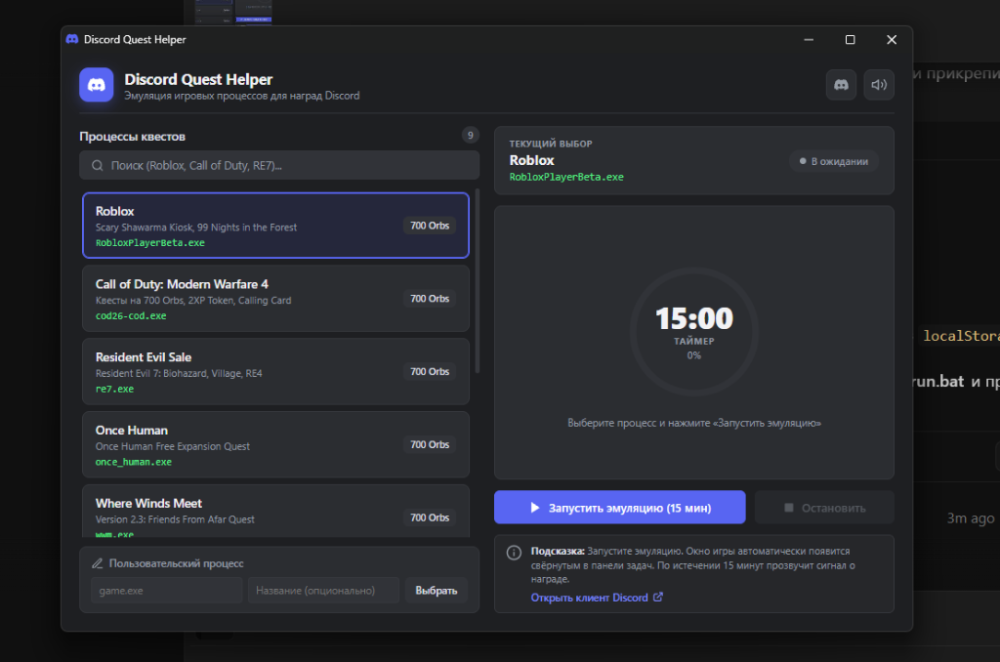

<p align="center">
  
</p>

<h1 align="center"><b>Discord Quest Helper</b></h1>

<p align="center">
  A lightweight, safe, and zero-dependency utility to complete <b>Discord Quests</b> (Orbs, avatar decorations, and rewards) without running heavy games.
</p>

<p align="center">
  <a href="https://github.com/veykax/discord-quest-helper/releases">Latest Release</a> •
  <a href="#how-to-use">How to Use</a> •
  <a href="#supported-games">Supported Games</a> •
  <a href="#tech-stack">Tech Stack</a> •
  <a href="#disclaimer">Disclaimer</a>
</p>

<div align="center">
  <a href="https://github.com/veykax/discord-quest-helper/releases">
    
  </a>
  
  
  
  
</div>

<p align="center">
  
</p>

<h5 align="center">
  Leave a star if you find this project helpful! ⭐️
</h5>

---

## About

**Discord Quest Helper** is a standalone, cross-platform desktop application that emulates the process signatures and window titles required by Discord Quests. It lets you complete 15-minute game quests in the background without installing gigabytes of game data or consuming CPU and GPU resources.

> **Safety Notice:** This application does **not** read or modify Discord client files, does not touch Discord process memory, and never asks for user tokens or passwords. Emulation operates entirely through native top-level window titles and Steam library manifests.

---

## Features

- **Auto-Detection of Active Quests:** Automatically reads active quests and real-time progress directly from Discord's local disk cache. 100% offline, zero network requests, zero token or account risk.
- **Auto-Sorting by Quest Status:** Games with active quests are highlighted and automatically prioritized to the top of your list.
- **Zero External Dependencies:** Compiles into a single standalone executable (~7 MB). Does not require Go, Python, Node.js, Electron, or browser extensions.
- **Cross-Platform Support:** Fully functional on **Windows** (10/11) and **Linux** (Flatpak & Native Discord installations).
- **Native Standalone Window:** Runs in an isolated, border-clean application window centered on your display with minimum size protection.
- **Process Lifecycle Sync:** Closing the simulation window from your taskbar automatically halts the quest timer.
- **Steam & Subpath Verification:** Supports relative directory paths (e.g., `win64/` for VALORANT, `once human/` for Once Human) and Steam library manifests (`appmanifest_*.acf` + `steam_appid.txt`).
- **Custom Game Support:** Add any custom `.exe` for future quests; entries persist locally across restarts.
- **Audio & Toast Alerts:** Built-in chime sound and dark-mode toast alerts notify you when the quest timer completes.
- **Bilingual Interface:** Instant EN/RU language switcher with persistent user preference.

---

## Supported Games

Includes verified quest signatures for popular titles:

- **Roblox** (`RobloxPlayerBeta.exe`)
- **Once Human** (`once human/once_human.exe`)
- **Call of Duty: Modern Warfare** (`cod26-cod.exe`)
- **Resident Evil 7 biohazard** (`re7.exe`)
- **Where Winds Meet** (`wwm.exe`)
- **Arknights: Endfield** (`endfield.exe`)
- **Firefox Browser** (`firefox.exe`)
- **VALORANT** (`win64/VALORANT-Win64-Shipping.exe`)
- **EA SPORTS FC 27** (`fc27.exe`, Steam Integration)
- **Custom Executables** (input any `.exe` and window title)

---

## How to Use

1. Open Discord, navigate to **User Settings $\rightarrow$ Quests**, and click **«Accept Quest»**.
2. Download and run the executable for your platform from [**Releases**](https://github.com/veykax/discord-quest-helper/releases) (no installation required):
   - **Windows:** `discord-quest-helper.exe`
   - **Linux:** `discord-quest-helper` (`chmod +x discord-quest-helper && ./discord-quest-helper`)
3. Select your target game from the list.
4. Click **«Start Quest (15 min)»**.
5. The game stub will run minimized in your taskbar.
6. Once the 15-minute timer completes, claim your reward directly in Discord!

---

## Tech Stack

* **Core Runtime:** [Go](https://go.dev/) (Go 1.23+)
* **Frontend:** HTML5, CSS3, Vanilla JavaScript (Embedded statically via `embed.FS`)
* **Window Engine:** Native Chromium Standalone App Mode (`--app`, `--window-size`, `--window-position`)
* **Process Emulation (Windows):** C# WinForms stub compiler (`csc.exe`) with taskbar minimization & Steam ACF manifest generator
* **Process Emulation (Linux):** Flatpak Bubblewrap namespace injector & pure Go X11 Wire Protocol window stub

---

## Development & Build

### Prerequisites
* [Go 1.22+](https://go.dev/dl/)

### Build Commands

```bash
# Windows build (GUI subsystem, stripped binary, embedded icon)
go build -ldflags="-s -w -H windowsgui" -o build/discord-quest-helper.exe

# Linux build (stripped binary)
go build -ldflags="-s -w" -o build/discord-quest-helper
```

Or run the included build scripts:
* Windows: `build.bat`
* Linux: `./build.sh`

---

## Disclaimer

This project is an independent community open-source utility and is **not affiliated with, endorsed, sponsored, or supported by Discord Inc.**

"Discord" and related trademarks, logos, and brand assets are the property of Discord Inc. All game titles, trademarks, and registered trademarks mentioned are the property of their respective owners and are used solely for identification and compatibility purposes.

---

## License

Distributed under the [MIT License](LICENSE).

<p align="center">
  <sub>Developed with human-AI pair programming assistance.</sub>
</p>
